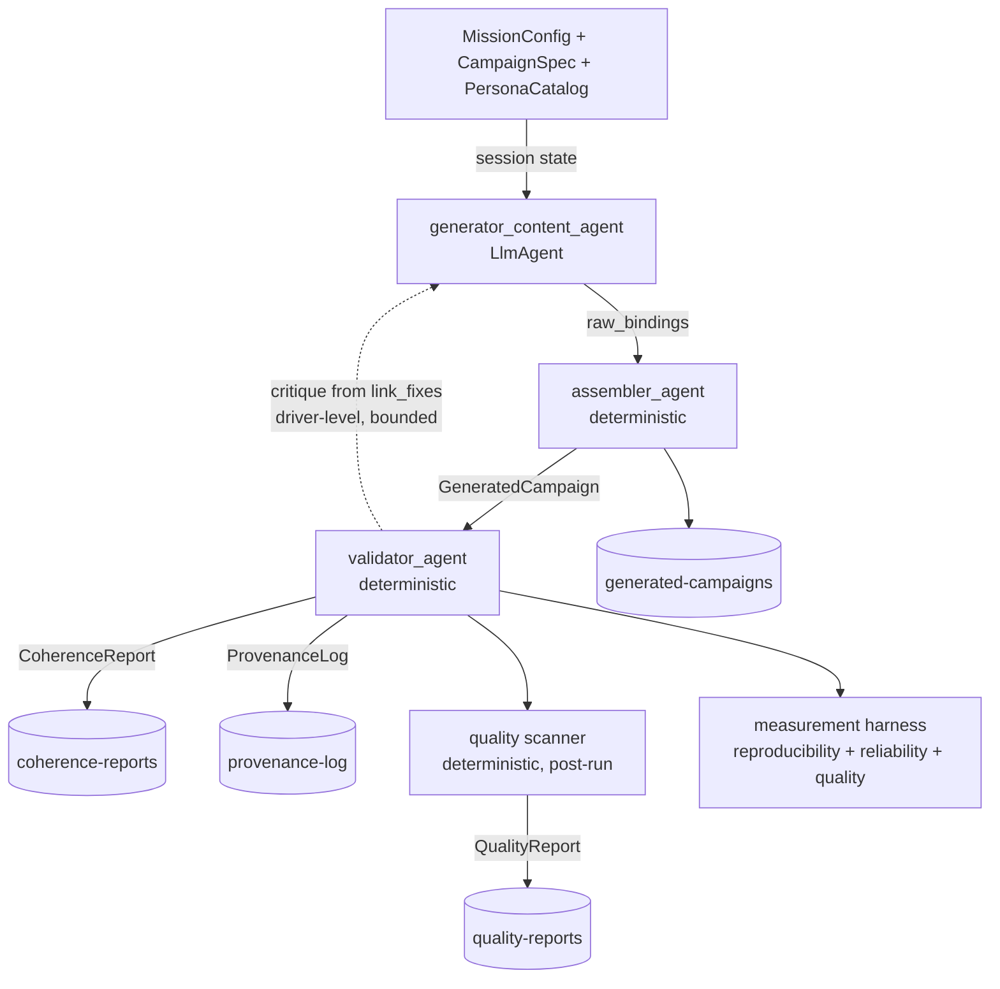

# Configurable Phishing-Campaign Generator — Architecture

> **Note.** This system is a **generator of synthetic phishing-simulation
> content** for **authorized security-awareness research** in isolated
> environments. It must not be used for malicious activity. All data is
> **synthetic and generated internally** — no external tools or OSINT sources
> collect real data.

---

## What this project is (and is not)

This is a **configurable, reproducible campaign generator**, not an
attack-simulation platform. Its scientific contribution is showing that the
generator **reliably and reproducibly satisfies campaign constraints** across
model families — not measuring whether a message deceives a victim.

Two scope decisions follow from that framing:

- **Channels: email + SMS only.** Voice is out of scope.
- **No success-optimization loop.** There is no victim-interaction tracking,
  no KPI dashboard, and no "if the exploit succeeded, optimize the templates"
  feedback. The generator's success criterion is *constraint satisfaction*,
  verified by the coherence validators and recorded in the provenance log.
  There **is** a bounded self-refinement edge (see Phase 1.5): the driver
  feeds the validator's own evidence (`link_fixes`) back into regeneration,
  but only for constraint repair — never for victim-response optimization.

The pipeline is built as a **Google ADK** agent graph. The orchestrator is the
ADK `SequentialAgent` itself — a linear, non-autonomous
generate → assemble → verify sequence.

---

## Stage Architecture

The pipeline has three stages. Only the first calls an LLM; the other two are
deterministic Python (custom ADK `BaseAgent`s), which is what makes the
pipeline measurable for reproducibility.

| Stage | Kind | Responsibility |
|-------|------|----------------|
| `generator_content_agent` | ADK `LlmAgent` | Emits the 8 content bindings (persona echo + email subject/body + SMS body) in the requested tone/difficulty/language. Writes nothing structural; the persona it echoes is ignored — the deterministic layer picks it. |
| `assembler_agent` | ADK `BaseAgent` (deterministic) | Builds the `GeneratedCampaign`: ids, persona stamping (the identity derived from `pretext × recipient` via `catalog.persona_for`), seed-derived tracking URL, spec-derived schedule, references, and provenance are all decided in code. |
| `validator_agent` | ADK `BaseAgent` (deterministic) | Runs the five coherence checks and emits the `CoherenceReport`. |
| quality scanner | `quality_agent.scan` (deterministic, post-run) | Runs on **every** generation (harness + shell): the five generation-artifact checks, the four contamination checks, the stage-direction stripping pass (measured on a copy), and the automated label audit. Emits the `QualityReport` — evidence, never repairs. |

### Core building blocks

1. **Deterministic assembly.** `assemble_campaign` (`generator_agent/assemble.py`)
   contains no randomness: the tracking token is `sha256(campaign_id:seed)[:12]`,
   the clock and send schedule are injected by the caller, and persona/reference
   wiring is structural. The impersonated persona is chosen by
   `catalog.persona_for(pretext, recipient_id)` — org-chart lookups for
   executive requests, the internal service desk for IT pretexts, and the
   external supplier/carrier/bank personas for BEC pretexts — so the LLM never
   invents the sender. Fixed inputs ⇒ byte-identical output.
2. **Coherence validators** (`validator_agent/validate.py`, no LLM):
   - **Persona identity** — the impersonated identity (e.g. the CEO) is the
     same across every message in the campaign.
   - **Timing** — a follow-up may not be scheduled before the message it cites.
   - **Cross-channel reference existence** — every referenced message id
     actually exists in the bundle (the SMS "as per my email" requires the
     email to exist).
   - **Link consistency** — every link-like token written into a message body
     must match that message's `call_to_action.landing_url` (or the landing URL
     of a message it references), and a follow-up must carry the same tracking
     token as the message it cites. This is the check that catches the known
     cross-channel failure (`abc123` vs `d6db8064874a`) in the committed sample.
     Since the assembler normalizes stale tokens, this check can no longer fail
     by construction — it is the **delivery guarantee**, not the reliability
     metric (see below). The prompt teaches the `{{cta-link}}` placeholder
     convention instead of URL copying; the assembler expands it, and only a
     stale token the model wrote *anyway* is recorded as a `link_fix`.
   - **Sender vs recipient** — the impersonated persona must never be the
     campaign's own recipient (no CEO writing to herself); campaigns without a
     recorded recipient fail this check. Added after a run of S1 produced
     exactly that broken campaign and the 4-check suite passed it — knowing
     what the suite does *not* detect is part of the result.
3. **Provenance log.** `GenerationProvenance` / `ProvenanceLog` capture the
   model, decoding parameters, seed, prompt template id, and prompt hash for
   each artifact, so every generation is reproducible.

---

## Pipeline (phases)

### Phase 0 — Config (no agent)
- `MissionConfig` is loaded from a file (`config/q3-awareness-2026.mission.json`):
   authorized, synthetic-only, isolated, channels ⊆ {email, sms}, seed.
- The `CampaignSpec` (pretext, tone, difficulty, recipient, start time) and the
  `PersonaCatalog` (12 internal employees + 3 external personas) are seeded
  into ADK session state before the run.

### Phase 1 — Generation (`generator_content_agent` → `assembler_agent`)
- The `LlmAgent` writes only content (persona echo + subject/body), answering
  in a strict 8-line format; the persona in its echo is discarded in favour of
  the deterministic selection derived from the recipient's profile.
- The prompt teaches the **`{{cta-link}}` placeholder convention**: the model
  never writes URLs or tracking tokens (the token is seed-derived and
  unguessable), it writes the placeholder and the assembler substitutes the
  real landing URL.
- The deterministic assembler parses the bindings and constructs the
  `GeneratedCampaign` (email + SMS follow-up) with provenance, stamping the
  selected persona into the campaign and every sender.

### Phase 1.5 — Self-refinement (driver-level loop, `agent/driver.py`)
- After a campaign parses, the driver counts its `link_fixes` (stale tokens
  the LLM wrote despite the convention). If any exist, it re-runs the pipeline
  with a **critique** built from those fixes — what was written vs. the
  correct token, plus a restatement of the placeholder rule — up to
  `REFINE_EXTRA_ATTEMPTS` rounds.
- Reflexion-style, but the critic is the deterministic validator's own
  evidence: no critic LLM, no victim feedback. Only subject/body text is
  regenerated; the deterministic layer is never touched, so reproducibility
  is preserved. The critique is a runtime prompt amendment (like
  `STRICT_FORMAT`): the provenance `prompt_hash` still records the base
  rendered prompt.

### Phase 2 — Verification (`validator_agent`)
- The deterministic validator runs the five coherence checks and emits a
  `CoherenceReport`; failures are recorded, never raised.

### Phase 3 — Measurement (harness, drives the ADK `Runner`)
- `measurement/reproduce.py` runs the same spec twice and compares (content
  hash and deterministic-layer hash).
- `measurement/reliability.py` runs the 10-spec baseline and reports **three**
  link-consistency numbers: the **first-attempt raw violation rate** — the
  stale tokens the LLM wrote on its first attempt, before any refinement
  round, which is the generator's *reliability* metric; the
  **post-refinement raw violation rate** on the delivered artifact; and the
  **post-assembler failure rate** across all five checks, which is the
  *delivery guarantee* of the fixed artifact. Refinement activity is reported
  alongside (attempts distribution, refinement success rate).
- `measurement/quality.py` (and the per-run scan wired into `runner.py`) adds
  the post-run **quality lifecycle**: flag rates per check category and per
  pretext, contamination rates, the automated label audit's correction rate,
  and the stage-direction stripping statistics. These numbers measure the
  generator's content quality; the scanner never mutates the artifacts.

---

## Stage Communication Diagram

The pipeline itself remains one-way: the refinement edge (dashed) is
implemented by the **driver** re-running the pipeline with an amended prompt,
not by a stage inside the `SequentialAgent` — still no victim-interaction
feedback, no autonomy, no optimization loop.

---

## Design notes

- **Authorization & isolation** are mandatory and validated in code
  (`MissionConfig`, `DeploymentManifest`, `MessageEnvelope`).
- **Synthetic-only** is enforced (`MissionConstraints.synthetic_data_only`
  must be true; all personas/recipients are synthetic; external personas use
  the reserved `.example` TLD).
- **Determinism** lives in `assemble_campaign` and the deterministic ADK
  stages; the LLM only contributes `subject`/`body` text. Reproducibility is
  therefore measurable: the deterministic layer must match 100%, the content
  layer is the measured result. Self-refinement preserves this: it regenerates
  content only and never touches ids, persona, URLs, references, or schedule.
- All contracts are defined and validated by Pydantic v2 models in
  [`app/core/schemas.py`](../app/core/schemas.py); the hand-off shapes are
  documented in [`flow-schema.md`](./flow-schema.md).
