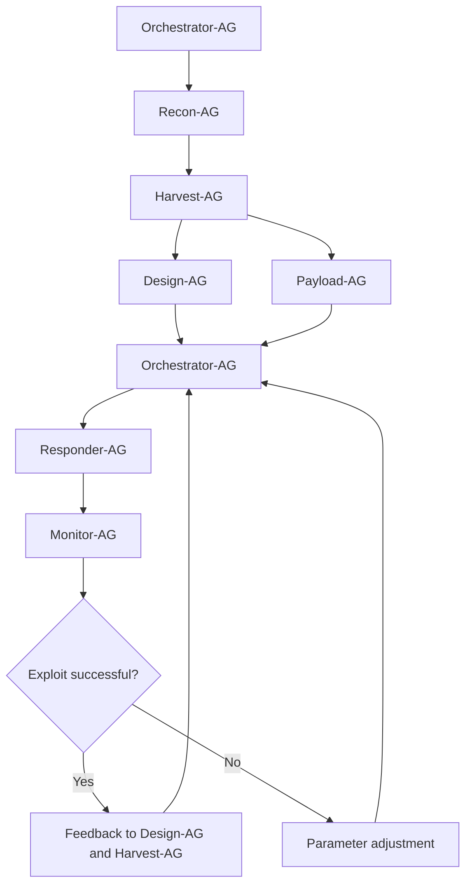

# Distributed Workflow for a Phishing Pipeline (Controlled Investigation)

> **Note**: This workflow is designed exclusively for **cybersecurity research** purposes, within isolated environments and under explicit authorization. It must not be used for malicious activities. All datasets are **synthetic and generated internally** — no external tools or OSINT sources are used to collect real data.

---

## Agent Architecture

| Agent | Role | Responsibility |
|--------|-----|-----------------|
| **Recon-AG** | Intelligence | Generation of synthetic target/domain data (no external collection) |
| **Harvest-AG** | Collection | Structuring of synthetic victim profiles into labeled datasets |
| **Design-AG** | Creative | Generation of communication templates (email, SMS, voice) |
| **Payload-AG** | Technical | Creation of malicious content (links, files) |
| **Responder-AG** | Interaction | Handles live victim interactions and automated responses across channels — email, SMS, and inbound/outbound voice calls; serves response cards (credentials, fake support, verification form) |
| **Orchestrator-AG** | Coordination | Launches campaigns, manages state, synchronizes agents |
| **Monitor-AG** | Analytics | Collects KPIs, generates reports, detects success patterns |

---

## Distributed Pipeline (Phases + Agents)

### Phase 0: Planning (Orchestrator-AG)
- Defines the objectives of the investigation.
- Assigns parameters: region, sector, volume, duration.
- Establishes ethics rules and interaction limits.

---

### Phase 1: Synthetic Reconnaissance (Recon-AG)
- Programmatic generation of synthetic domains (similar/typo patterns).
- Definition of simulated attack surfaces (mail servers, forms, APIs) as synthetic metadata.
- No external scanning or live data collection is performed.
- **Output**: Synthetic list of potential targets + attack surfaces.

---

### Phase 2: Dataset Construction (Harvest-AG)
- Generation of synthetic victim profiles (no OSINT or external sources).
- Classification by: role, seniority, devices used, language patterns.
- **Output**: Labeled synthetic dataset (JSON/CSV) with profiles.

---

### Phase 3: Content Generation (Design-AG + Payload-AG)
- **Design-AG**: Creates email/SMS/call templates with A/B testing.
- **Payload-AG**: Generates:
  - Shortened links with tracking.
  - Files (PDFs, Excel) with macros or redirects.
  - Mirror pages (cloning of legitimate sites).
- **Output**: Set of campaigns ready to deploy.

---

### Phase 4: Controlled Launch (Orchestrator-AG)
- Segments the dataset into batches.
- Schedules sends with randomized timing (realistic simulation).
- Assigns channels: primary email, secondary SMS, call as reinforcement.

---

### Phase 5: Interaction Handling (Responder-AG)
- Handles live responses to victim interactions across channels: email, SMS, and voice calls.
- Selects the appropriate response card: credentials, fake support, or verification form.
- Sustains realistic conversation flow for inbound and outbound calls.
- **Output**: Interaction transcripts + logged results forwarded to Monitor-AG.

---

### Phase 6: Monitoring and KPIs (Monitor-AG)
- Computes real-time metrics:
  - Delivery, open, click, and conversion rates (data submission).
  - Response time, bounce rate, reported-as-spam rate.
- Generates dashboards and anomaly alerts.
- **Decision**: If **exploit successful** → feeds back to Design-AG to optimize templates (design pattern learning).

---

### Phase 7: Feedback (Orchestrator-AG + Monitor-AG)
- Updates the dataset with observed behaviors.
- Retrains response cards (tree improvement).
- Adjusts domains and designs according to success patterns.

---

## Agent Communication Diagram

