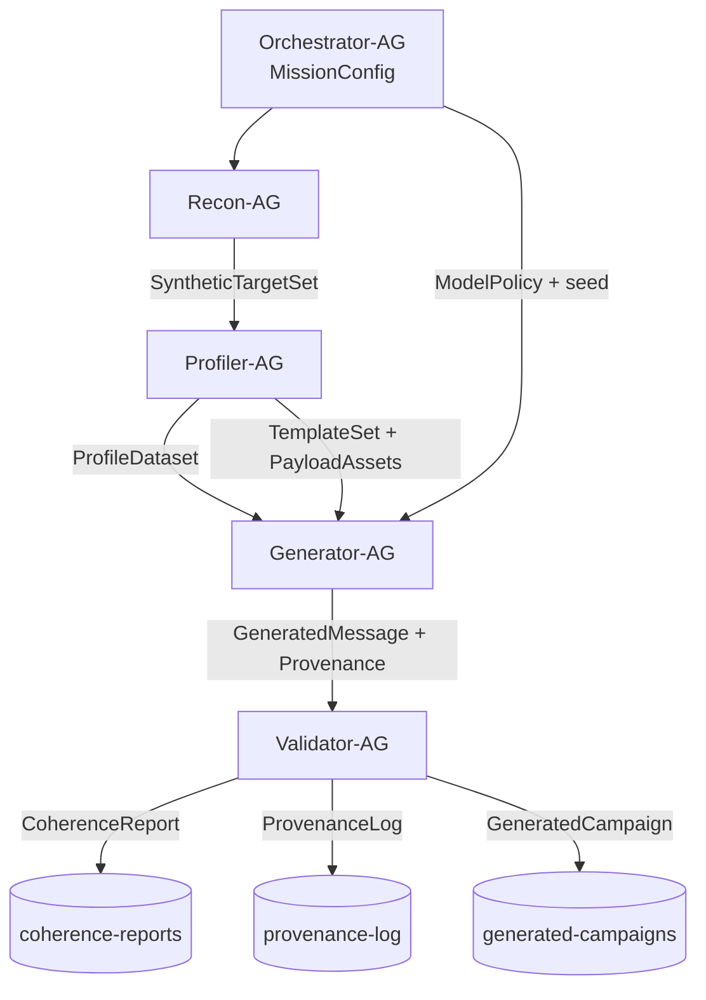

# Configurable Phishing-Campaign Generator — Architecture

> **Note.** This system is a **generator of synthetic phishing-simulation
> content** for **authorized security-awareness research** in isolated
> environments. It must not be used for malicious activity. All data is
> **synthetic and generated internally** — no external tools or OSINT sources
> collect real data.

---

## What this project is (and is not)

This is a **configurable, reproducible campaign generator**, not an
attack-simulation platform. Its scientific contribution is showing that the
generator **reliably and reproducibly satisfies campaign constraints** across
model families — not measuring whether a message deceives a victim.

Two scope decisions follow from that framing:

- **Channels: email + SMS only.** Voice is out of scope.
- **No success-optimization loop.** There is no victim-interaction tracking,
  no KPI dashboard, and no "if the exploit succeeded, optimize the templates"
  feedback. The generator's success criterion is *constraint satisfaction*,
  verified by the coherence validators and recorded in the provenance log.

---

## Stage Architecture

The pipeline is decomposed into five single-responsibility stages coordinated
by an orchestrator. (These replace the earlier seven-agent attack pipeline.)

| Stage | Role | Responsibility |
|-------|------|----------------|
| **Orchestrator-AG** | Coordination | Reads the `MissionConfig`, enforces constraints, fixes the reproducibility seed and model policy, drives the run. |
| **Recon-AG** | Intelligence | Generates synthetic targets/domains (typo/homoglyph patterns) and simulated attack surfaces — no external collection. |
| **Profiler-AG** | Synthetic data | Structures labeled synthetic recipient profiles from the targets (no external collection). |
| **Generator-AG** | LLM generation | Generates email and SMS content through **model-family adapters** (≥ 2 families), recording provenance for every artifact. |
| **Validator-AG** | Coherence & provenance | Runs the coherence validators and finalizes the append-only provenance log. |

### Core building blocks (the part that was missing)

1. **Model-family adapters.** `ModelSpec` (family + model + adapter version)
   and `GenerationParams` (with a required `seed`) let the generator target at
   least two distinct model families. `ModelPolicy` enforces the "≥ 2 families"
   rule at the campaign level so results are comparable across families.
2. **Coherence validators.** Enforced in `GeneratedCampaign`:
   - **Persona identity** — the impersonated identity (e.g. the CEO) is the
     same across every message in the campaign.
   - **Timing** — a follow-up may not be scheduled before the message it cites.
   - **Cross-channel reference existence** — every referenced message id
     actually exists in the bundle (the SMS "as per my email" requires the
     email to exist).
3. **Provenance log.** `GenerationProvenance` / `ProvenanceLog` capture the
   model, decoding parameters, seed, prompt template id, and prompt hash for
   each artifact, so every generation is reproducible.

---

## Pipeline (Phases + Stages)

### Phase 0 — Planning (Orchestrator-AG)
- Reads `MissionConfig`: objective, scope, constraints (`channels ⊆ {email, sms}`),
  `model_policy` (≥ 2 families), `reproducibility` (seed), and ethics guardrails.
- Rejects any config that is not authorized, not synthetic-only, or not isolated.

### Phase 1 — Synthetic Reconnaissance (Recon-AG)
- Programmatic generation of synthetic domains (typo/homoglyph patterns) and
  simulated attack surfaces as metadata — **no external scanning**.
- **Output**: `SyntheticTargetSet`.

### Phase 2 — Profiling & Content Inputs (Profiler-AG → Generator-AG)
- Labeled synthetic recipient profiles (role, seniority, devices, language) built
  from the recon targets — **no external collection**. Output: `ProfileDataset`.
- Seed **prompt templates** (`TemplateSet`) the generator conditions on, per
  channel and pretext, with A/B variants.
- Simulation assets (`PayloadAssets`): tracking links and sandboxed
  attachments/mirror pages, all marked `simulated`.

### Phase 3 — Generation (Generator-AG)
- For each recipient/persona, the generator produces one or more
  `GeneratedMessage`s across email and SMS via the selected `ModelSpec` adapter.
- Each message carries its `GenerationProvenance`.
- **Output**: `GeneratedMessage`s, batched by `DeploymentManifest`.

### Phase 4 — Coherence & Provenance (Validator-AG)
- Assembles the `GeneratedCampaign` (persona + messages) and runs the three
  coherence validators; emits a `CoherenceReport`.
- Finalizes the append-only `ProvenanceLog` for reproducibility.
- **Output**: `CoherenceReport`, `ProvenanceLog`.

---

## Stage Communication Diagram

There is intentionally **no edge back into generation** — the pipeline is a
one-way generate-then-verify flow, not an optimization loop.

---

## Design notes

- **Authorization & isolation** are mandatory and validated in code
  (`MissionConfig`, `DeploymentManifest`, `MessageEnvelope`).
- **Synthetic-only** is enforced (`SyntheticTargetSet`/`ProfileDataset` require
  `source == "synthetic"`; `MissionConstraints.synthetic_data_only` must be true).
- All contracts are defined and validated by Pydantic v2 models in
  [`app/core/schemas.py`](../app/core/schemas.py); the per-hand-off JSON shapes
  are documented in [`flow-schema.md`](./flow-schema.md).
