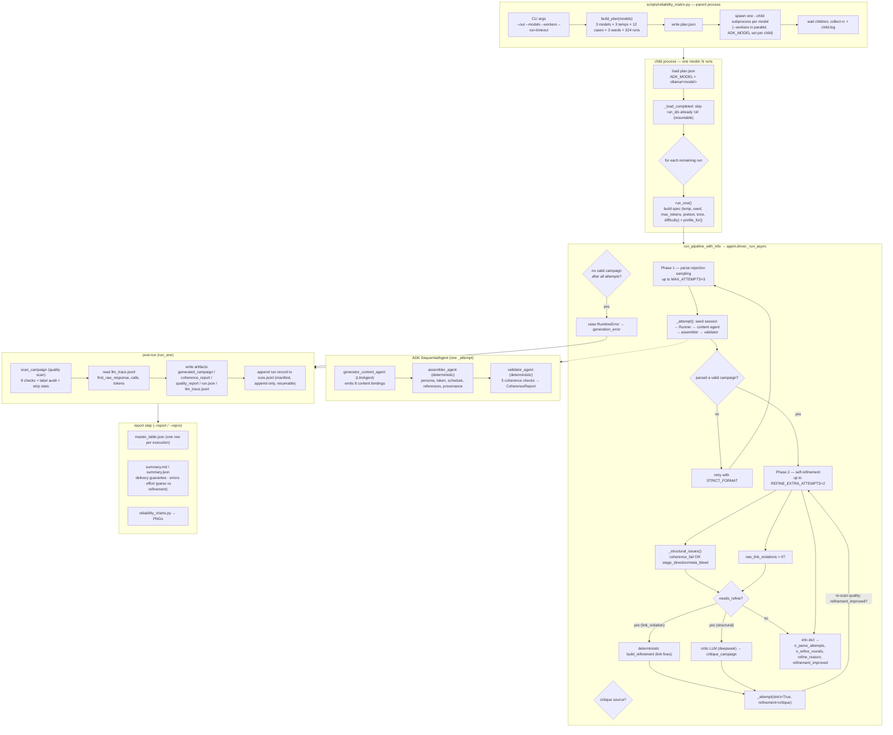

# Reliability Harness — Flow

This Mermaid diagram is the authoritative flow of the reliability harness
(`scripts/reliability_matrix.py`) and the ADK pipeline it drives, as of the
current build (with the split parse/refinement instrumentation and the
corrected quality detectors).

## Key flow notes

1. **Parent** only builds the 324-cell plan and spawns one child per model (in
   parallel batches of `--workers`). It never runs the pipeline itself.
2. **Child** fixes `ADK_MODEL` to the model's frozen tag, then iterates its runs,
   skipping any `run_id` already recorded `ok` in the manifest (re-sumable).
3. **`run_one`** builds the spec (temperature/seed/max_tokens + pretext/tone/
   difficulty) and calls the real ADK pipeline.
4. **Phase 1** retries parsing up to 3 times with `STRICT_FORMAT`.
5. **Phase 2** refines up to 2 rounds when there is a *real* signal — a stale
   link token or a genuine structural finding (stage-direction / meta-bleed).
   The critique is either the critic LLM (structural) or the deterministic link
   `build_refinement` (links). Each round re-measures quality flags to record
   `refinement_improved`.
6. **Post-run** runs the quality scan, folds the LLM trace, writes artifacts,
   and appends one line to the append-only `runs.jsonl` manifest.
7. **Report** summarizes from the manifest: delivery guarantee (coherence, a
   construction invariant), errors by constraint, and effort split into parse
   vs refinement rounds.
