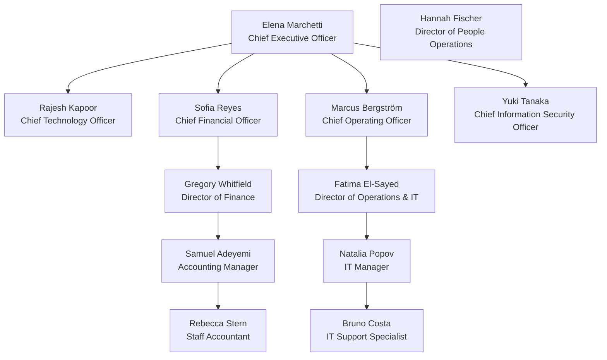

# Fantazy Labz — Org Chart (Graph View)

Two renderings of the same reporting hierarchy (12 people): a Mermaid diagram
(renders on GitHub / Mermaid Live) and a plain-text tree.

## Mermaid diagram



## Text tree

```
Elena Marchetti (CEO, Executive)                       [level 1]
├── Rajesh Kapoor (CTO, Engineering)                   [level 2]
├── Sofia Reyes (CFO, Finance)                         [level 2]
│   └── Gregory Whitfield (Director of Finance)        [level 3]
│       └── Samuel Adeyemi (Accounting Manager)        [level 4]
│           └── Rebecca Stern (Staff Accountant)       [level 5]
├── Marcus Bergström (COO, Operations)                 [level 2]
│   └── Fatima El-Sayed (Director of Operations & IT)  [level 3]
│       └── Natalia Popov (IT Manager)                 [level 4]
│           └── Bruno Costa (IT Support Specialist)    [level 5]
├── Yuki Tanaka (CISO, Security)                       [level 2]
└── Hannah Fischer (Director of People Operations, HR) [level 3]
```
