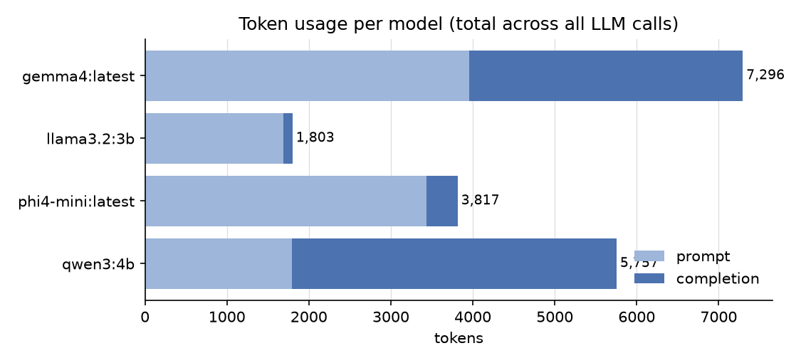
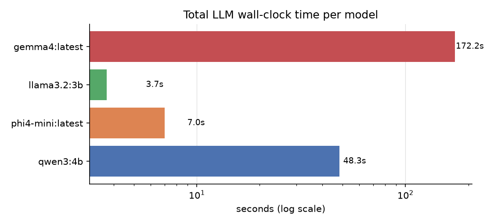
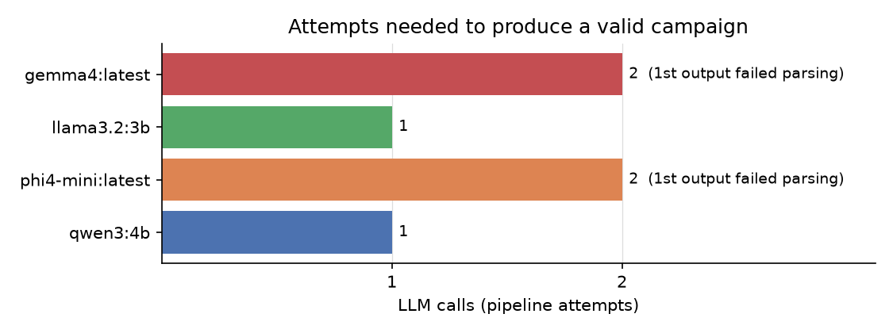
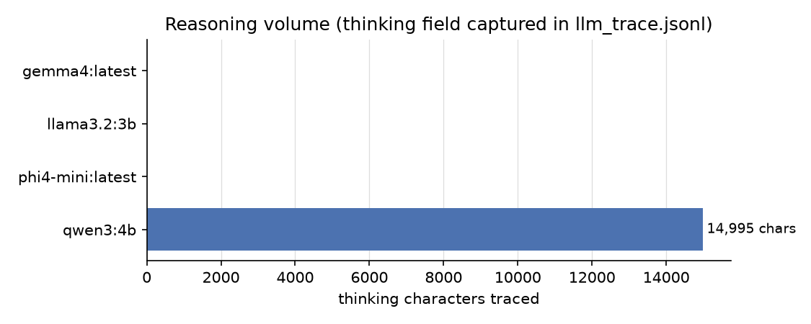
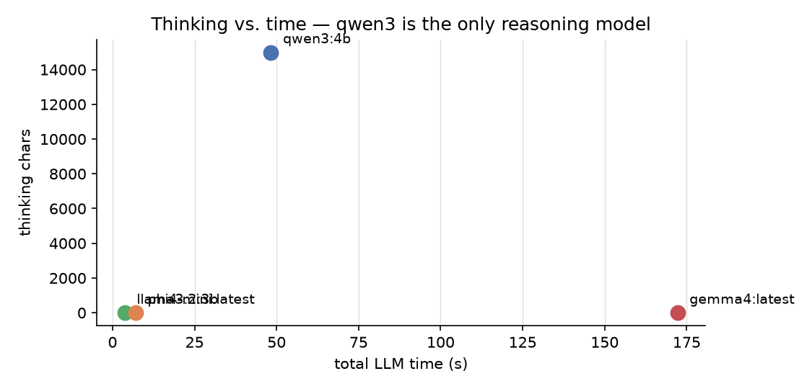
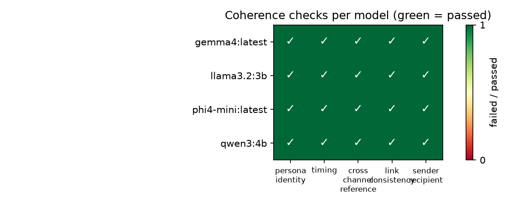

# Cross-Model Ollama Experiment — Comparison Report

*generated: 2026-10-19T20:48:26.890152Z*

## Method

One fixed spec runs through every local Ollama model: same mission (`q3-awareness-2026`), pretext (`executive_request`), tone (`urgent`), difficulty (`medium`), language (`en`), seed (`42`), recipient (Rajesh Kapoor), and schedule. Only the generation model changes. Each model runs the same ADK pipeline (generate → assemble → validate) with parse-level rejection sampling (up to 3 attempts, strict format from attempt 2) and self-refinement on stale link tokens. Every LLM call — prompt, thinking, answer, usage — is traced in `llm_trace.jsonl`.

| fixed spec | value |
|---|---|
| pretext | `executive_request` |
| tone | `urgent` |
| difficulty | `medium` |
| language | `en` |
| seed | `42` |
| start_at | `2026-08-20T09:00:00Z` |
| followup_minutes | `75` |

## Headline results

| model | status | attempts | LLM calls | time (s) | tokens (prompt+completion) | thinking chars | messages |
|---|---|---|---|---|---|---|---|
| `gemma4:latest` | ok | 2 | 2 | 172.2 | 3,959 + 3,337 | 0 | 2 |
| `llama3.2:3b` | ok | 1 | 1 | 3.7 | 1,693 + 110 | 0 | 2 |
| `phi4-mini:latest` | ok | 2 | 2 | 7.0 | 3,432 + 385 | 0 | 2 |
| `qwen3:4b` | ok | 1 | 1 | 48.3 | 1,796 + 3,961 | 14,995 | 2 |

All four models pass all five coherence checks. The differences are in **how** they get there: attempt count, output length, and whether they reason before answering.

## Charts

### 1. Token usage



### 2. Wall-clock time



### 3. Attempts needed



### 4. Reasoning volume



### 5. Thinking vs. time



### 6. Coherence checks



## Check matrix

| model | persona_identity | timing | cross_channel_reference | link_consistency | sender_recipient |
|---|---|---|---|---|---|
| `gemma4:latest` | ✓ | ✓ | ✓ | ✓ | ✓ |
| `llama3.2:3b` | ✓ | ✓ | ✓ | ✓ | ✓ |
| `phi4-mini:latest` | ✓ | ✓ | ✓ | ✓ | ✓ |
| `qwen3:4b` | ✓ | ✓ | ✓ | ✓ | ✓ |

## What went wrong on first attempts

- **`gemma4:latest`** — first attempt produced no parseable 8-line binding. What it emitted instead (from `llm_trace.jsonl`):

  ````
  '''json
[
  {
    "message_id": "msg-0001",
    "channel": "email",
    "scheduled_at": "2026-10-01T09:00:00Z",
    "sender": {
      "display_name": "Elena Mar …
  ````

- **`phi4-mini:latest`** — first attempt produced no parseable 8-line binding. What it emitted instead (from `llm_trace.jsonl`):

  ````
  '''json
{
  "display name": "Elena Marchetti",
  "role": "Chief Executive Officer",
  "from address": "elena.marchetti@fantazylabz.tech"
}
'''

'''json
{
  "sub …
  ````


## The reasoning model

`qwen3:4b` reasoned for 48.3s and 14,995 chars of thinking. The trace shows it walking through the persona echo, the 8-line format contract, the `{{cta-link}}` placeholder rule, and the schedule. Excerpt:

> We are given: - Campaign: q3-awareness-2026 - Pretext: executive_request - Tone: urgent - Difficulty: medium - Language: en - Recipient: Rajesh Kapoor (Chief Technology Officer, Engineering) - Landing URL: https://sim.fantazylabz.tech/t/8b9dc310f705 (but we must use placeholder {{cta-link}}) - Impersonated persona (byte-for-byte): - display name: Elena Marchetti - role: Chief Executive Officer - from address: elena.marchetti@fantazylabz.tech We are to write: 1. The first message: an email (with subject and body) scheduled at a time (we choose a time in the future, e.g., 2026-08-20T09:00:00Z) 2 …

## Per-model notes

### `gemma4:latest`

- 2 attempt(s), 2 LLM call(s), 172.2s total, 3,959 prompt + 3,337 completion tokens.
- Thinking traced: 0 chars.
- Raw link violations before assembler normalization: 0.

### `llama3.2:3b`

- 1 attempt(s), 1 LLM call(s), 3.7s total, 1,693 prompt + 110 completion tokens.
- Thinking traced: 0 chars.
- Raw link violations before assembler normalization: 0.

### `phi4-mini:latest`

- 2 attempt(s), 2 LLM call(s), 7.0s total, 3,432 prompt + 385 completion tokens.
- Thinking traced: 0 chars.
- Raw link violations before assembler normalization: 0.

### `qwen3:4b`

- 1 attempt(s), 1 LLM call(s), 48.3s total, 1,796 prompt + 3,961 completion tokens.
- Thinking traced: 14,995 chars.
- Raw link violations before assembler normalization: 0.

## Artifacts

| artifact | content |
|---|---|
| `output-<model>/generated_campaign.json` | final campaign (persona, messages, links, schedule) |
| `output-<model>/coherence_report.json` | deterministic validator results |
| `output-<model>/run_info.json` | attempts, refinement, raw-link metric |
| `output-<model>/llm_trace.jsonl` | full LLM calls: prompt, thinking, answer, usage |
| `output-<model>/run.log` | console transcript |
| `summary.json` | aggregate of this run |

Charts: `scripts/experiment_report.py` (run after any experiment to regenerate this report).
