# Variety experiment — quality lifecycle summary

- generated: `2026-10-28T19:08:17.992002Z` · dir: `experiment/variety-pilot-20261028T181724Z`
- runs: 32 (ok 32, ok=32)
- campaigns with >= 1 quality flag: 11/32 (rate 0.3438)
- contaminated campaigns: 1/32 (rate 0.0312)
- label-correction rate: 0.7812 (mismatch {'pretext': 0, 'tone': 9, 'difficulty': 20}, unverifiable {'pretext': 1, 'tone': 6, 'difficulty': 0})
- strip-affected campaigns: 0/32 (rate 0.0); 0 chars would be removed from 0 messages

## Findings by check

| check | findings | campaigns flagged |
|---|---|---|
| `dialogue_collapse` | 0 | 0 |
| `stage_direction` | 0 | 0 |
| `turn_overflow` | 7 | 7 |
| `meta_bleed` | 7 | 4 |
| `loop_detection` | 1 | 1 |
| `pretext_contamination` | 1 | 1 |
| `name_contamination` | 0 | 0 |
| `brand_contamination` | 0 | 0 |
| `script_contamination` | 0 | 0 |

## Contamination by category

| category | campaigns |
|---|---|
| `pretext_contamination` | 1 |
| `name_contamination` | 0 |
| `brand_contamination` | 0 |
| `script_contamination` | 0 |

## Coherence (validator) failures

| check | campaigns failing |
|---|---|
| `persona_identity` | 0 |
| `timing` | 0 |
| `cross_channel_reference` | 0 |
| `link_consistency` | 0 |
| `sender_recipient` | 0 |

## Per model

| model | runs | quality flag rate | contamination rate | label correction rate | coherence failure rate | median duration |
|---|---|---|---|---|---|---|
| `llama3.1:8b` | 8 | 0.25 | 0.0 | 0.625 | 0.0 | 39.9s |
| `qwen3:8b` | 8 | 0.25 | 0.0 | 0.75 | 0.0 | 58.0s |
| `gemma4:latest` | 8 | 0.125 | 0.125 | 1.0 | 0.0 | 69.7s |
| `phi4-mini:latest` | 8 | 0.75 | 0.0 | 0.75 | 0.0 | 74.3s |

## Per temperature (sweep)

| temperature | runs | unique-body ratio | near-dup rate | retry rate | refinement rate | quality flag rate | mean attempts |
|---|---|---|---|---|---|---|---|
| `0.0` | 8 | 1.0 | 0.0 | 0.625 | 0.625 | 0.25 | 2.12 |
| `0.5` | 8 | 1.0 | 0.0 | 0.625 | 0.625 | 0.5 | 2.12 |
| `0.8` | 8 | 1.0 | 0.0 | 0.25 | 0.25 | 0.25 | 1.5 |
| `1.2` | 8 | 1.0 | 0.0 | 0.375 | 0.375 | 0.375 | 1.75 |

## Flag rate by pretext

| pretext | runs | flagged | rate | contaminated | contamination rate |
|---|---|---|---|---|---|
| `password_reset` | 32 | 11 | 0.3438 | 1 | 0.0312 |

### Most common label corrections (spec label -> runs)

- `tone`: urgent->9
- `difficulty`: easy->13, medium->7

## Refinement activity

- campaigns refined: 15 (15/32)
- total attempts: 60 (mean per campaign 1.88)
- raw link violations (final artifact): 0 (first-attempt: 0)

## Charts

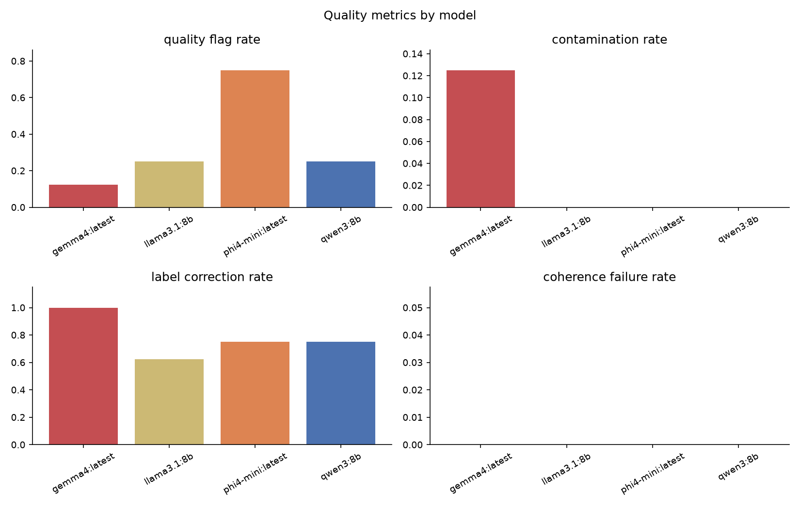

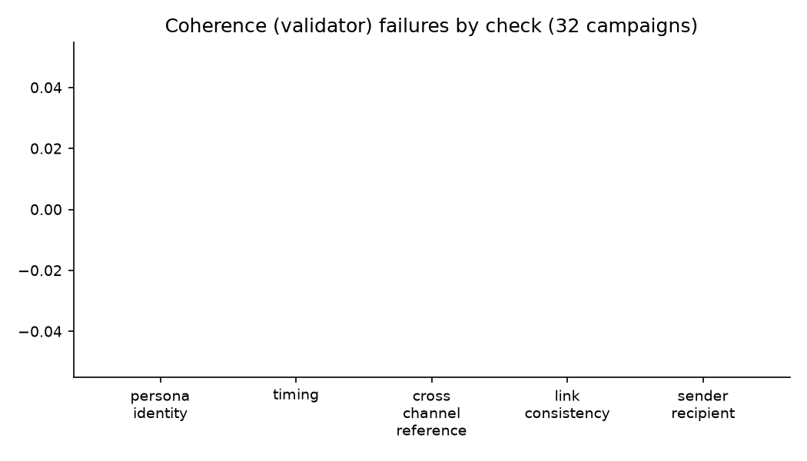

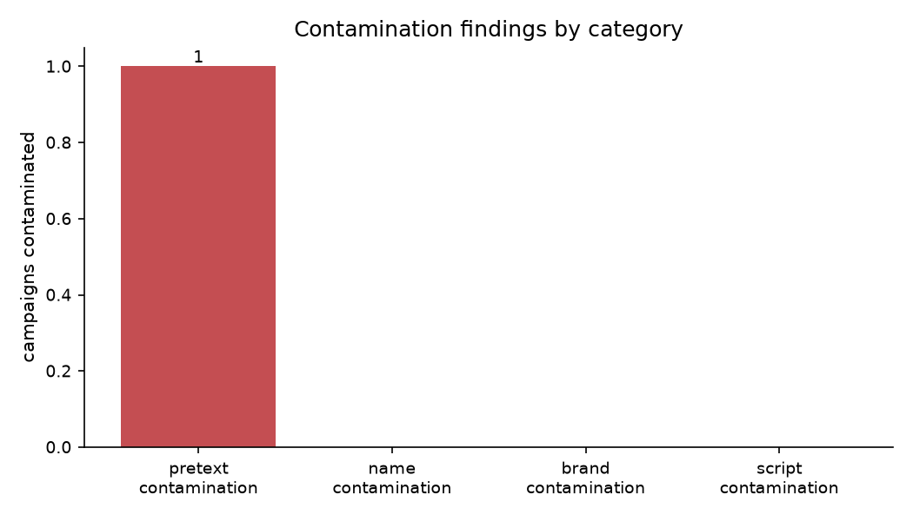

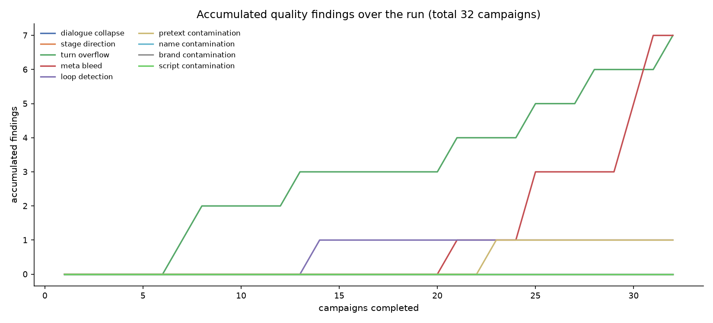

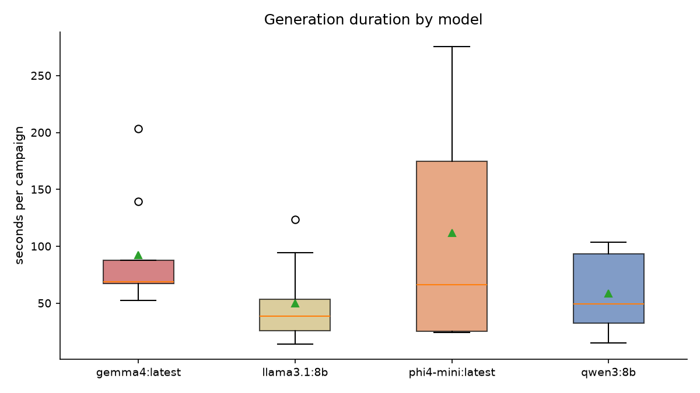

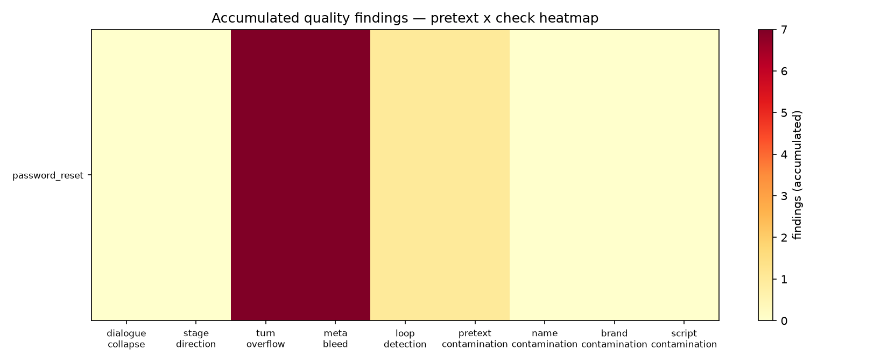

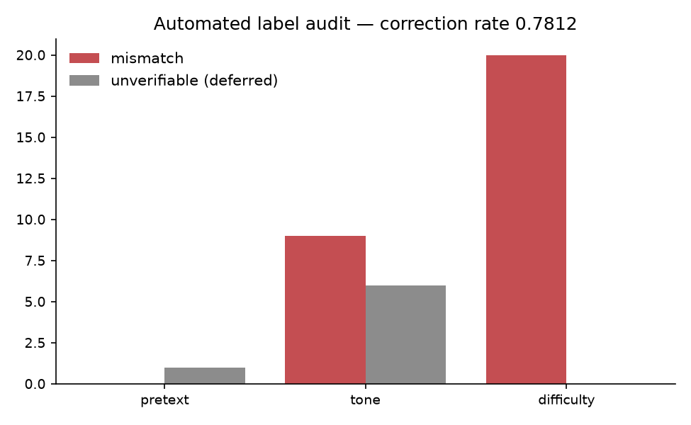

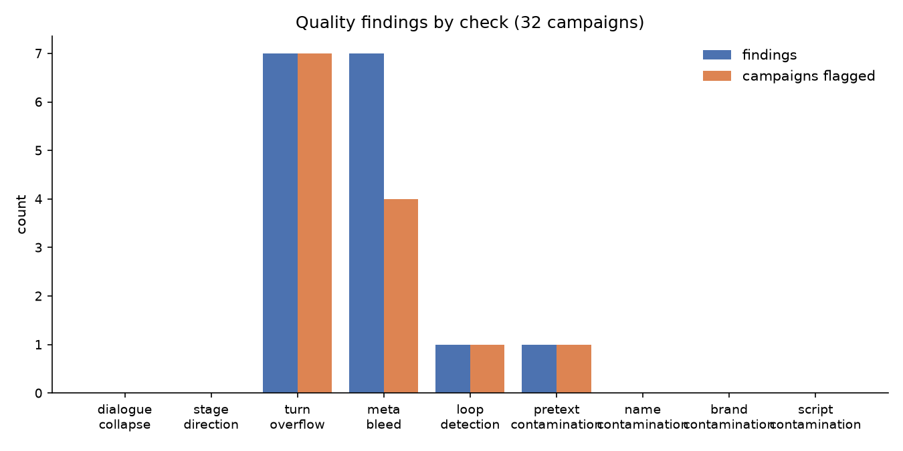

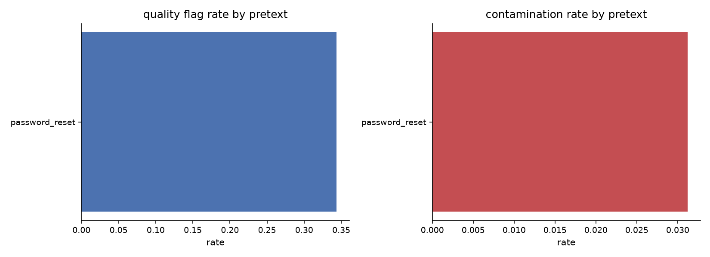

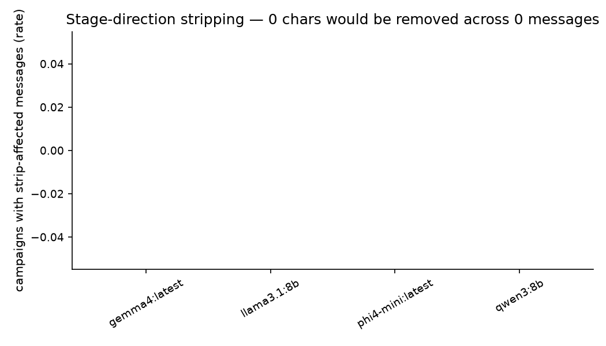

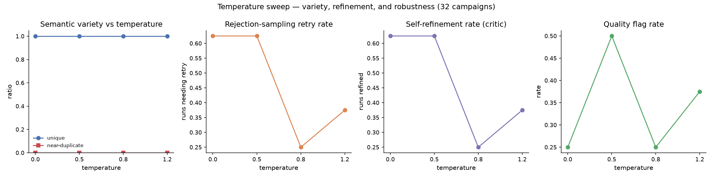

> Quality findings are evidence, never repairs: the delivered campaigns are untouched by the scan, and every number above measures the generator, not a cleanup of its output.
