# Fantazy Labz — Org Chart (Graph View)

Two renderings of the same reporting hierarchy: a Mermaid diagram (renders
on GitHub / Mermaid Live) and a plain-text tree.

## Mermaid diagram

```mermaid
graph TD
    P1["Elena Marchetti<br/>Chief Executive Officer"]
    P2["Rajesh Kapoor<br/>Chief Technology Officer"]
    P3["Sofia Reyes<br/>Chief Financial Officer"]
    P4["Marcus Bergström<br/>Chief Operating Officer"]
    P5["Priya Venkataraman<br/>Chief Marketing Officer"]
    P6["Daniel O'Brien<br/>Chief Human Resources Officer"]
    P7["Yuki Tanaka<br/>Chief Information Security Officer"]
    P8["Aisha Nasser<br/>VP of Engineering"]
    P9["Tomás Herrera<br/>Director of Data & AI"]
    P10["Nina Kowalski<br/>Director of Product"]
    P11["Gregory Whitfield<br/>Director of Finance"]
    P12["Fatima El-Sayed<br/>Director of Operations & IT"]
    P13["Lucas Andersson<br/>Director of Customer Success"]
    P14["Beatriz Coelho<br/>Director of Marketing"]
    P15["Ethan Caldwell<br/>Director of Sales"]
    P16["Hannah Fischer<br/>Director of People Operations"]
    P17["Omar Haddad<br/>Director of Security Operations"]
    P18["Ravi Deshmukh<br/>Backend Engineering Manager"]
    P19["Clara Jensen<br/>Frontend Engineering Manager"]
    P20["Kwame Osei<br/>DevOps Manager"]
    P21["Mei Lin<br/>Machine Learning Manager"]
    P22["Julian Vasquez<br/>Senior Product Manager"]
    P23["Ingrid Larsson<br/>UX Design Lead"]
    P24["Samuel Adeyemi<br/>Accounting Manager"]
    P25["Natalia Popov<br/>IT Manager"]
    P26["Diego Morales<br/>Support Manager"]
    P27["Chloe Dubois<br/>Content Marketing Manager"]
    P28["Anthony Russo<br/>Regional Sales Manager"]
    P29["Grace Mwangi<br/>Talent Acquisition Manager"]
    P30["Viktor Novák<br/>SOC Manager"]
    P31["Leo Fontaine<br/>Backend Engineer"]
    P32["Amara Okonkwo<br/>Backend Engineer"]
    P33["Simon Bauer<br/>Frontend Engineer"]
    P34["Yara Haddadin<br/>Frontend Engineer"]
    P35["Pavel Sokolov<br/>Site Reliability Engineer"]
    P36["Hana Kim<br/>Machine Learning Engineer"]
    P37["Isaac Bennett<br/>Data Scientist"]
    P38["Camila Rojas<br/>Product Analyst"]
    P39["Theo Lindqvist<br/>UX Designer"]
    P40["Rebecca Stern<br/>Staff Accountant"]
    P41["Bruno Costa<br/>IT Support Specialist"]
    P42["Layla Karimi<br/>Customer Support Specialist"]
    P43["Marco Bianchi<br/>Customer Support Specialist"]
    P44["Olivia Grant<br/>Content Writer"]
    P45["Noah Schmidt<br/>Digital Marketing Specialist"]
    P46["Zoe Palmer<br/>Account Executive"]
    P47["Felipe Navarro<br/>Sales Development Representative"]
    P48["Sara Lindholm<br/>Recruiter"]
    P49["Kevin Boateng<br/>HR Generalist"]
    P50["Elif Yılmaz<br/>Security Analyst"]

    P1 --> P2
    P1 --> P3
    P1 --> P4
    P1 --> P5
    P1 --> P6
    P1 --> P7
    P2 --> P8
    P2 --> P9
    P2 --> P10
    P3 --> P11
    P4 --> P12
    P4 --> P13
    P5 --> P14
    P5 --> P15
    P6 --> P16
    P7 --> P17
    P8 --> P18
    P8 --> P19
    P8 --> P20
    P9 --> P21
    P10 --> P22
    P10 --> P23
    P11 --> P24
    P12 --> P25
    P13 --> P26
    P14 --> P27
    P15 --> P28
    P16 --> P29
    P17 --> P30
    P18 --> P31
    P18 --> P32
    P19 --> P33
    P19 --> P34
    P20 --> P35
    P21 --> P36
    P21 --> P37
    P22 --> P38
    P23 --> P39
    P24 --> P40
    P25 --> P41
    P26 --> P42
    P26 --> P43
    P27 --> P44
    P27 --> P45
    P28 --> P46
    P28 --> P47
    P29 --> P48
    P16 --> P49
    P30 --> P50
```



## ASCII reporting tree

```text
Elena Marchetti — Chief Executive Officer (L1)
├── Rajesh Kapoor — Chief Technology Officer (L2)
│   ├── Aisha Nasser — VP of Engineering (L3)
│   │   ├── Ravi Deshmukh — Backend Engineering Manager (L4)
│   │   │   ├── Leo Fontaine — Backend Engineer (L5)
│   │   │   └── Amara Okonkwo — Backend Engineer (L5)
│   │   ├── Clara Jensen — Frontend Engineering Manager (L4)
│   │   │   ├── Simon Bauer — Frontend Engineer (L5)
│   │   │   └── Yara Haddadin — Frontend Engineer (L5)
│   │   └── Kwame Osei — DevOps Manager (L4)
│   │       └── Pavel Sokolov — Site Reliability Engineer (L5)
│   ├── Tomás Herrera — Director of Data & AI (L3)
│   │   └── Mei Lin — Machine Learning Manager (L4)
│   │       ├── Hana Kim — Machine Learning Engineer (L5)
│   │       └── Isaac Bennett — Data Scientist (L5)
│   └── Nina Kowalski — Director of Product (L3)
│       ├── Julian Vasquez — Senior Product Manager (L4)
│       │   └── Camila Rojas — Product Analyst (L5)
│       └── Ingrid Larsson — UX Design Lead (L4)
│           └── Theo Lindqvist — UX Designer (L5)
├── Sofia Reyes — Chief Financial Officer (L2)
│   └── Gregory Whitfield — Director of Finance (L3)
│       └── Samuel Adeyemi — Accounting Manager (L4)
│           └── Rebecca Stern — Staff Accountant (L5)
├── Marcus Bergström — Chief Operating Officer (L2)
│   ├── Fatima El-Sayed — Director of Operations & IT (L3)
│   │   └── Natalia Popov — IT Manager (L4)
│   │       └── Bruno Costa — IT Support Specialist (L5)
│   └── Lucas Andersson — Director of Customer Success (L3)
│       └── Diego Morales — Support Manager (L4)
│           ├── Layla Karimi — Customer Support Specialist (L5)
│           └── Marco Bianchi — Customer Support Specialist (L5)
├── Priya Venkataraman — Chief Marketing Officer (L2)
│   ├── Beatriz Coelho — Director of Marketing (L3)
│   │   └── Chloe Dubois — Content Marketing Manager (L4)
│   │       ├── Olivia Grant — Content Writer (L5)
│   │       └── Noah Schmidt — Digital Marketing Specialist (L5)
│   └── Ethan Caldwell — Director of Sales (L3)
│       └── Anthony Russo — Regional Sales Manager (L4)
│           ├── Zoe Palmer — Account Executive (L5)
│           └── Felipe Navarro — Sales Development Representative (L5)
├── Daniel O'Brien — Chief Human Resources Officer (L2)
│   └── Hannah Fischer — Director of People Operations (L3)
│       ├── Grace Mwangi — Talent Acquisition Manager (L4)
│       │   └── Sara Lindholm — Recruiter (L5)
│       └── Kevin Boateng — HR Generalist (L5)
└── Yuki Tanaka — Chief Information Security Officer (L2)
    └── Omar Haddad — Director of Security Operations (L3)
        └── Viktor Novák — SOC Manager (L4)
            └── Elif Yılmaz — Security Analyst (L5)
```